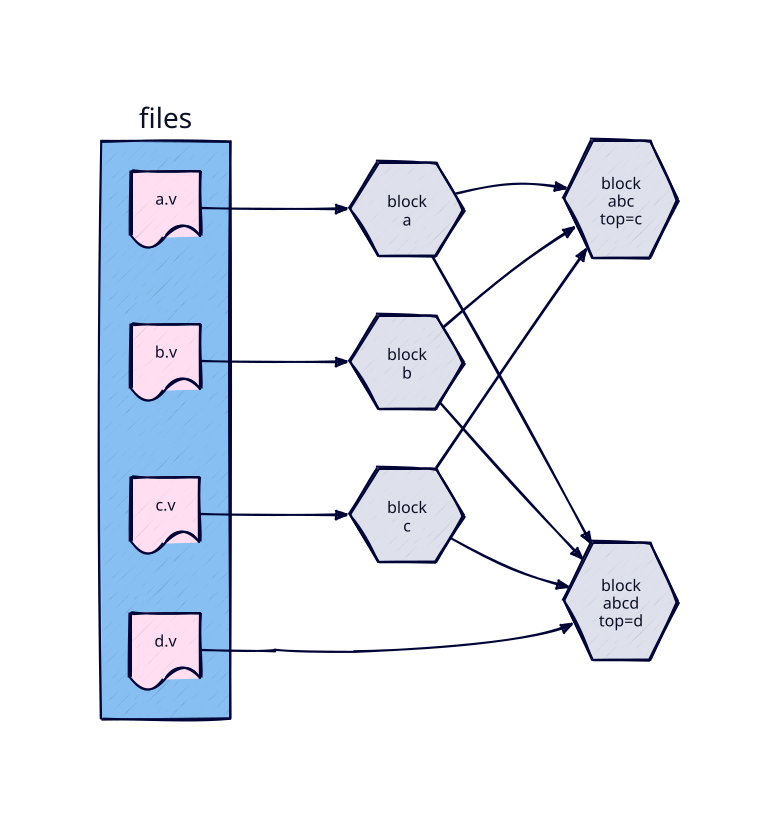
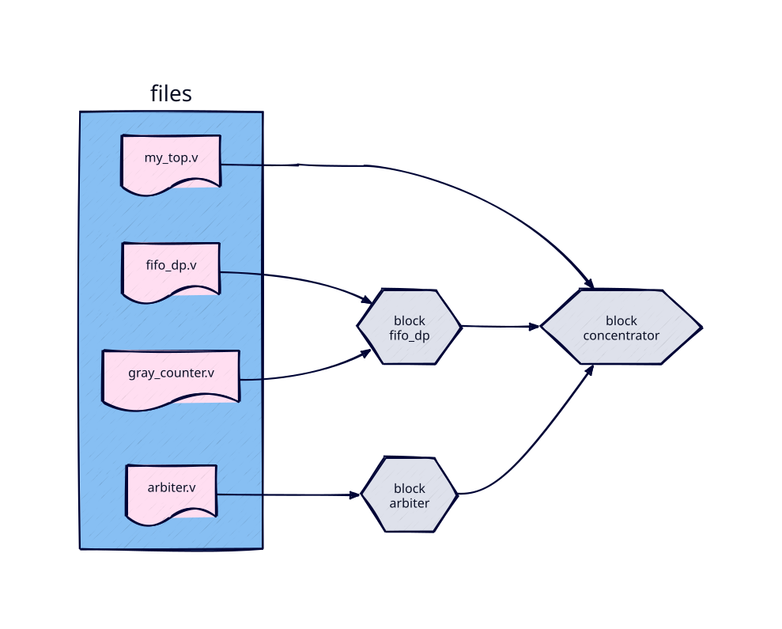

# Design Modeling
This section focuses on modeling design (RTL and implementation) related aspects using *bake*.
A manifest declares three kinds of design component:

| Function | Declares | Used as |
|---|---|---|
| `block()` | a design in RTL | a target; included by other blocks |
| `macro()` | an implemented block (a hard macro): its netlist and abstracts | a target; included by RTL blocks, which place it as a macro |
| `lib()` | a cell library (standard cells, IO cells, technology files) | named in `libs=`: what blocks are mapped onto |

`macro()` and `lib()` take the same netlist and abstract arguments; they differ in role.

## Blocks
A manifest defines design units using the `block()` function. `target()`, its old name, still
works but is deprecated: it logs a warning and will be removed in a future major release of
*bake*. The full syntax is:

```python
block(name, desc, includes, top, rtl_files, rtl_incdirs, libs,
      sdc_files, vcd_files, saif_files, release_recipe)
```

Arguments:

  * `name` — name used to reference this block from the command line and from other manifest entries
  * `desc` — human-readable description (optional, documentation only)
  * `includes` — blocks to inherit from (see [Inheritance](#inheritance)) — optional
  * `top` — name of the top-level Verilog module for this block
  * `rtl_files` — Python list of RTL files (typically Verilog or SystemVerilog)
  * `rtl_incdirs` — Python list of include directory paths (relative or absolute) — optional
  * `libs` — Python list of *bake* library names (PDK cell libraries) — optional; a block that
    declares none uses `config.bake.default_libs`, so shared RTL can be implemented in whatever
    libraries the project that includes it sets
  * `sdc_files` — design constraint files — optional
  * `vcd_files`, `saif_files` — switching-activity files for power analysis, per corner
    (`{"tt": ["run.vcd"]}`); a plain list or a single file is the `"default"` corner — optional
  * `release_recipe` — the recipe that builds the block where a parent includes a release of it
    and none is selected (see [Releases](#releases)); default `config.release.recipe` — optional

`block()` declares RTL only. A block implemented elsewhere is declared with
[`macro()`](#macros), and a netlist argument given to `block()` is reported as such.

## Manifest Conventions
### File References
File and directory paths in manifests can be either relative or absolute. Relative paths are
resolved relative to the manifest file they appear in, and are converted to absolute paths at
invocation time. This means downstream tools invoked by *bake* always see absolute paths.

All file and directory names are validated to exist at invocation time. This catches typos and
missing files early, before any tool is invoked. `layout_info` is the exception: it may name
several LEF files or directories separated by spaces, and one that does not exist is a warning.

Wherever a list of files is expected, a single file may be given as a string, and `pathlib.Path`
objects are accepted in place of strings. In the corner dictionaries (`liberty_files`,
`si_files`, `vcd_files`, `saif_files`) a corner may map to a single file instead of a list.

### Source Templates
A source file whose name ends in `.tpl` (`tb.sv.tpl`, `core.v.tpl`) is a
[Jinja](https://github.com/pallets/jinja) template of that source. Before a step's flow starts,
*bake* renders it with the step's template variables (the `$BAKE_*` ones the flow receives, lists
kept as lists) and hands the flow the rendered file, named without `.tpl`, in its place. Use it
for what the preprocessor writes badly: code repeated over names no `genvar` can index, such as
the instances a netlist flattens out of generate scopes.

```systemverilog
//# The state registers of a pixel, by the names synthesis gives their cells
//% set netlist = "NETLIST" in BAKE_SIM_DEFINES
module tb;
  //% for r in range(4)
  //%   for p in range(4)
  //%     if netlist
  //%       set pixel = "u_core.gen_regions_%d_gen_pixels_%d_u_pixel" % (r, p)
  //%     else
  //%       set pixel = "u_core.gen_regions[%d].gen_pixels[%d].u_pixel" % (r, p)
  //%     endif
  assign hit_probe[${r * 4 + p}] = ${pixel}.hit_o;
  //%     if netlist
  initial begin
    //% for i in range(10)
    $deposit(${pixel}.counter_reg_${i}.IQ, 1'b0);
    //% endfor
  end
  //%     endif
  //%   endfor
  //% endfor
endmodule
```

A source template is a `.tpl` file like a flow's scripts, and `${BAKE_TOP}` means the same in
both, but it is rendered by Jinja rather than by `$BAKE_*` substitution: write `${BAKE_TOP}`,
not `$BAKE_TOP` (left as it is, like any other `$`), and use the loops and conditions below.
The delimiters suit HDL: `{{ }}` is a SystemVerilog replication, so an expression is `${ }`; a line starting with `//%` is a statement and one starting with
`//#` a comment, both comments to an editor or linter reading the template. `` and
`{# #}` work too, and the `do` and loop-control (`break`, `continue`) extensions are enabled.
A variable nobody defines is an error that names the template's file and line, and the flow does
not start.

A template is a source of the step like any other: editing it makes the step stale. The rendered
file lives under the step's work directory, in a directory named after a digest of its text
(the `vrf` step's under `_build/src/`, next to the builds its tests share), so tests that render a
template alike compile the same file and may share a build, while tests that render it
differently do not overwrite each other.

### Inheritance
Blocks (and environments, introduced later) can inherit content from other items of the same
type via an `includes` field. The item listed in `includes` is the *parent*; the newly defined
item is the *child*. Inheritance rules are straightforward:

  * Parents are processed in order of occurrence in the `includes` list.
  * For primitive (string) fields such as `top`:
    * If the child specifies a value, it overrides any parent value.
    * If the child omits the field, the first parent's value is inherited.
  * For list fields such as `rtl_files`, parent and child lists are merged:
    * Parent elements are inserted before child elements.
    * Duplicates in the merged list are removed.
    * The relative order within each list is preserved.

Examples:
```python
block(name="a", rtl_files=["a.v"])
block(name="b", rtl_files=["b.v"])
block(name="c", rtl_files=["c.v"], top="c")

block(name="abc", includes=["a", "b", "c"])
# block abc:
#   rtl_files = ["a.v", "b.v", "c.v"]
#   top = "c"  (inherited from c)

block(name="abcd", includes=["a", "b", "c"], rtl_files=["d.v"], top="d")
# block abcd:
#   rtl_files = ["a.v", "b.v", "c.v", "d.v"]
#   top = "d"  (overrides parent)
```



The `includes` field accepts either a list of block names (short form) or a dictionary mapping
block names to recipe strings (long form). The list form is a shorthand where every included
block is taken at its RTL step:

```python
# Short form — equivalent to {"a": "rtl", "b": "rtl"}
block(name="abc", includes=["a", "b"])
```

The dictionary form lets a block declare a dependency on the *output* of a specific recipe
rather than the source RTL. What the included block's recipe produced then stands in for its
RTL, and each step of the parent takes what it needs from it: `vrf` simulates the sub-block's
netlist (with its SDF), `impl` integrates the sub-block as a hard macro from its abstracts —
the LEF and Liberty files its own `impl` wrote — and passes its netlist on for the simulation
that may follow:

```python
# Long form — the sub-block is consumed after its "impl" step
block(
    name="concentrator",
    top="concentrator",
    rtl_files=["concentrator.v"],
    includes={"sub_block": "impl"},
)
```

What an include resolves to has a *kind* — RTL, an implemented block, or a kind a loaded tool
defines, such as an `rdl()` register map — and a block takes only some: an RTL block takes RTL
(merged into its own) and implemented blocks (integrated as hard macros), and a `macro()`
includes nothing. An include of another kind names a recipe that converts it
(`includes={"regs": "rdl2verilog"}`); a wrong one is reported, with the recipe that would
convert it, once all manifests are loaded.

Such an include is a *dependency*. The manifest only declares it; whether `sub_block impl` has
been run is decided when a recipe is elaborated, and the dependency is built (or rebuilt when
its sources changed) before the parent's own steps run:

```
$ bake concentrator vrf        # runs "sub_block impl" first if needed, then simulates
```

`bake` with no arguments shows the state of every dependency (`not built`, `stale`, `up to
date`), and `bake concentrator vrf -n` reports what a run would do without executing anything.
Included blocks may be defined later in the manifest; unknown blocks, unknown steps in the
recipe and include cycles are reported once all manifests are loaded.

```
$ bake concentrator impl       # hierarchical: sub_block placed as a macro
$ bake concentrator impl-vrf   # gate-level simulation of both netlists
```

Each step takes certain kinds of data — RTL, or an implemented block — and refuses a recipe
that hands it another: `tmr` and `impl` take RTL, so `impl-tmr` is refused before anything
runs (see [Data Kinds](custom_steps.md#data-kinds)). A step also refuses an include that lacks
what the step needs: the built-in `impl` requires
the sub-block's abstracts, which the built-in flow writes whenever the libraries provide LEF
(synthesis-only runs produce a netlist but no macro). A block that instantiates a hard macro
cannot override its parameters — the macro's ports are fixed — so instantiate it with its
defaults. To implement the hierarchy flat instead, use the RTL form of the include.

## Hierarchical RTL Designs
Using inheritance, larger designs can be decomposed into smaller, reusable units. This keeps
manifests concise and allows simulating sub-blocks independently without duplicating file lists.

```python
block(name="fifo_dp", top="fifo_dp", rtl_files=["fifo_dp.v", "gray_counter.v"])
block(name="arbiter", top="arbiter", rtl_files=["arbiter.v"])

block(name="concentrator", top="my_top", rtl_files=["my_top.v"], includes=["fifo_dp", "arbiter"])
```



This allows independently simulating the FIFO block and running implementation on the full chip:
```
$ bake fifo_dp vrf                # RTL simulation of FIFO block
$ bake concentrator tmr-impl      # TMR + implementation of top level
$ bake concentrator tmr-impl-vrf  # TMR + implementation + gate-level simulation
```

## Blocks Without RTL Files
Blocks that declare neither `rtl_files` nor `includes` are valid and can be registered (for
example, to share `sdc_files` or `libs` among the blocks that include them). They do not appear
in the runnable block listing and cannot be used as the target of a recipe. This makes them
useful as shared containers that can be referenced via `includes` without polluting the
command-line target list.

## Macros
The `macro()` function declares an implemented block — a hard macro, digital or analog, whose
netlist and abstracts come from elsewhere — by the same files as a [library](#libraries):

```python
macro(name, desc, top, libs, netlist_files, netlist_incdirs, liberty_files, si_files, layout_info,
      stream_files, lvs_files)
```

Arguments:

  * `name` — name used to reference this macro from the command line and from `includes`
  * `desc` — human-readable description (optional, documentation only)
  * `top` — name of the macro's module (its cell name)
  * `libs` — cell libraries its netlist is mapped to — optional; as for `block()`,
    `config.bake.default_libs` when it declares none
  * `netlist_files`, `netlist_incdirs`, `liberty_files`, `si_files`, `layout_info` — as for
    [`lib()`](#libraries)
  * `stream_files` — its layout (GDS, OASIS), for a flow that merges it into the parent's
    (optional)
  * `lvs_files` — its netlists for LVS (CDL, SPICE), for a parent's LVS (optional)

A macro is what `impl` makes of an RTL block, so the two are used the same way:

```python
macro(
    name="frontend",
    top="frontend",
    netlist_files=["frontend/frontend.v"],        # behavioral or gate-level model
    liberty_files={"TT": "frontend/frontend_tt.lib", "SS": "frontend/frontend_ss.lib"},
    layout_info="frontend/frontend.lef",
)
block(name="pixel", top="pixel", rtl_files=["pixel.v"], includes=["frontend"])
```

  * A block that includes it gets it as a macro: `impl` places it from its LEF and Liberty
    files (`$BAKE_MACRO_*`, see [Configuration](configuration.md)) and `vrf` simulates its
    netlist together with the block's RTL. `impl` requires `layout_info` and `liberty_files`
    for every corner the flow uses.
  * It is a target itself: `bake frontend vrf` simulates its netlist with the tests that target
    it. Steps that take RTL, such as `tmr` and `impl`, refuse it.
  * It includes nothing, and it is not a cell library: naming it in `libs=` is an error, as is
    including a `lib()`. A testbench may still name it in `vrf_libs=` to simulate with its
    netlist.

### Macros from a LEF alone

A macro made elsewhere, an analog one say, may come as a LEF only. The `blackbox` step writes
the views it lacks from its top cell in the LEF, and hands the macro on with them:

  * a port-only Verilog module (`netlist_files`), its buses from the highest bit down, since a
    LEF does not say in which order a bus runs; power and ground pins left out, unless
    `config.blackbox.supplies`;
  * a black-box Liberty cell (`liberty_files`): its area, its signal pins and buses, and the
    timing `config.blackbox.pins` gives; one file, listed for every corner of
    `config.blackbox.corners` (those of the flow that places the macro).

```python
macro(name="adc", top="adc", layout_info="adc/adc.lef")
block(name="column", top="column", rtl_files=["column.v"], includes={"adc": "blackbox"})

config.blackbox.corners = ["SS", "TT", "FF"]
config.blackbox.pins["adc"] = {
    "clk":   {"clock": True, "capacitance": 0.004},
    "start": {"related_pin": "clk", "setup": 0.3, "hold": 0.1},
    "dout":  {"related_pin": "clk", "delay": 1.5, "transition": 0.2},   # a bus: every bit
}
```

A LEF holds no timing: what `pins` does not give, the Liberty file does not say. A digital pin
it leaves untimed (neither a clock nor related to one) is listed as a warning when the step
runs; `ANALOG` and `inout` pins are not. The keys of a pin, in ns, pF:

| Key | Meaning |
|---|---|
| `clock` | the pin is a clock |
| `capacitance` | input capacitance |
| `max_transition` | the largest transition the pin takes or drives |
| `related_pin`, `edge` | the clock the next keys refer to, and its active edge (`rising`, the default, or `falling`) |
| `setup`, `hold` | an input's setup and hold times |
| `delay`, `transition` | an output's delay after the clock edge, and its transition time |

A view the macro declares is kept, so `blackbox` on a macro with a netlist but no Liberty writes
the Liberty only; on a macro that has both it is an error. The values are the same in every
corner: for timing that differs by corner, write the Liberty files by hand. `bake.lef` reads the
LEF and writes both views; a project's flow may import it (`lef.read()`, `lef.verilog()`,
`lef.liberty()`), since a Python flow runs under bake's interpreter.

### Checking that a macro's views agree

Each view of an implemented block lists the ports of its top cell: its LEF, its Liberty files, its
netlist and its LVS netlist. Nothing else makes them agree, and a pin renamed in one of them, a
bus that runs the other way or a direction that differs shows up late, in place and route or in
LVS. The `portscheck` step reads the top cell from each view the block has and compares them;
it hands the block on unchanged, so it goes anywhere in a recipe on lib data:

```shell
bake frontend portscheck             # a macro() as declared
bake core impl-portscheck            # what impl wrote
bake adc blackbox-portscheck         # what blackbox wrote
```

```python
block(name="column", ..., includes={"adc": "release-portscheck"})   # a release, before it is used
```

| Finding | Severity |
|---|---|
| a port some views lack | error, but for a power or ground pin (to a LEF or a Liberty `pg_pin`) missing from the netlist or the Liberty files, which commonly leave supplies out |
| a supply that a Liberty file declares as a signal pin | warning |
| directions that differ, among the views that give one | error |
| bits of a bus that differ, or a bus that runs the other way in two views that give an order (a LEF gives none) | error |

It writes `portscheck.md` and `portscheck.json` in its output directory and fails on an error,
or on a warning too with `config.portscheck.strict`.
`config.portscheck.waive[block] = {port: reason}` accepts the findings on a port: they are
reported with the reason, and do not fail. The views are read by their files' suffixes: LEF (`.lef`), Liberty (`.lib`), Verilog and SystemVerilog (`.v`, `.sv`,
`.vg`; the module's header, ANSI or not, with ranges on its parameters), SPICE and CDL (`.cdl`,
`.sp`, `.spi`, `.spice`, `.cir`; the `.SUBCKT` line, with Calibre's `*.PININFO` for directions).
`bake.ports` reads and compares them; a flow with a view of its own (an OpenAccess library read
through a vendor's tool) builds an `Interface` of it and calls `ports.compare()` the same way.

## Releases

A block implemented once can be used from one of its **releases** instead of being built again:
its netlist and abstracts saved, with where they come from and how they fared in their checks
(see [Release Format](release_format.md)). A parent asks for that with the `release` recipe:

```python
block(name="core", top="core", rtl_files=["core.v"])
block(name="column", top="column", rtl_files=["column.v"], includes={"core": "release"})
```

The include resolves when a recipe of the parent is elaborated:

  * when `config.release.use` selects a release of `core`, `{"core": "release"}` is that
    release: nothing of `core` is built, not even what `core` itself includes, and `column`
    gets the release's files, as it gets those of `{"core": "impl"}`;
  * otherwise `core` is built with its **fallback recipe**, `config.release.recipe` (`impl` by
    default) or the block's own `release_recipe=`, in that recipe's work directory: without a
    selection, `{"core": "release"}` is `{"core": "impl"}`.

```python
config.release.path = ["/shared/releases"]          # where to find them
config.release.use = {"core": "20261118-edef189"}   # which one; -o release.use.core=... for a run
```

A release is refused when it was built in another project, with other values of the project's
options than the run's, or with a cell library the project does not declare.

`release` is always the first step of a recipe: further steps run on the release's data, in the
block's own work directory (`{"core": "release-lef2oa"}`). `bake core release` builds nothing
when a release is selected (it reports it) and builds `core` with its fallback recipe otherwise.
A plain `{"core": "impl"}` is never replaced by a release.

### Variants

`config.release.use` holds for the whole run, so one block is built either on a release or
on its fallback. To have both side by side (a release next to the current sources, two
releases), declare a **variant**:

```python
variant("column", "tapeout1", release={"core": "20261118-edef189"})
```

`column@tapeout1` is `column` (its includes, files, tests and copies of flows, under `flow/column/`)
with a work directory of its own, `<output dir>/column@tapeout1/`, and the releases it names,
which take precedence over `config.release.use` for everything built under it. Its flows see
`$BAKE_BLOCK` as `column`, so the settings a flow keys on the block's name hold for the
variant too, and `$BAKE_VARIANT` as `tapeout1` (empty for a block that is not a variant).
`bake column@tapeout1 impl` builds it; a variant copies a block that is built, not an external
block or another variant.

### External blocks

A block made outside the project, an analog one say, may exist only as releases. Declare it
with `external()`, naming the [source file](release_format.md#source-files) its makers fill in
(relative to the manifest), and include it with `release`:

```python
external(name="adc", top="adc_top", source="/analog/adc/adc.ini", desc="Column ADC")
block(name="column", top="column", rtl_files=["column.v"], includes={"adc": "release"})
config.release.use["adc"] = "20261201"
```

Each time its makers hand it over, `bake adc publish` makes a release of the files the source
file names, under `config.publish.root`, for the project and the values of its options. Its
version is `config.publish.name`, or the date (`<date>-<time>` when the date is taken); it
checks that the views agree and does not run the project's publish flow, which reads an impl
run. Files that did not change since the last publish are not published again.
`-o publish.source=<file>.ini` publishes from another source file, once.

An external block includes nothing and has no fallback recipe: without a selected release, a
recipe that needs it stops and says how to select one. Any recipe on it but `publish` and those
starting with `release` is an error.

## Sweeps

A sweep runs one block's recipe once per variant, each variant a set of `-o` overrides, and
reports the variants side by side: what a choice still open costs, before the choice is made.
It is declared with `sweep()`, a block of its own kind, and run by the `sweep` step:

```python
from bake import sweep

sweep(name="pitch", desc="Which pixel pitch fits the core?",
      target="core", recipe="impl",
      options=["signoff=true"],                              # an -o for every variant
      variants={"p100": ["pixel_pitch=100"],
                "p120": ["pixel_pitch=120"],
                "p150": ["pixel_pitch=150"]})
```

```
bake pitch sweep
```

| Argument | Description |
|----------|-------------|
| `target` | The block whose recipe the variants run |
| `recipe` | What each variant runs: `impl`, `tmr-impl`, `vrf`, ... |
| `options` | `-o` overrides for every variant: `option=value` for an option of the project, `section.attribute=value` for a section's attribute |
| `variants` | `{name: [overrides]}`; a variant's name names its run directory, and one override may be given as a string |
| `desc` | The question the sweep answers, at the top of its report |

The choices a sweep varies are settings that decide what is built — the project's options
(see [Project options](configuration.md#project-options)), which the manifests see while they
load, or any step's settings. Every variant is a *bake* invocation of the recipe —
`bake <target> <recipe>` with the sweep's options, the variant's, then those of the sweep's own
command line — in a directory of its own (`config.bake.output_dir`). The directories are kept,
so running the sweep again runs only the variants whose inputs changed.

### On this machine

The default flow, `builtin_sweep_flow`, runs the variants in parallel on the machine *bake* runs
on, each in `work/<sweep>/sweep/runs/<variant>/` with its output in `run.log`. It keeps
`report.md` and `results.csv` next to them, rewritten whenever a variant finishes, so the report
also says how far the sweep is, and fails the step if a variant did not pass. A variant whose
flow finished without every output its step expects — a run stopped before the end of its flow
on purpose, say — is *partial*: reported as such, but not a failure of the sweep. `sweep.pid` holds
the process that stops the sweep: `kill $(cat work/<sweep>/sweep/sweep.pid)` (or Ctrl-C) stops
every running variant.

`report.md` is laid out to be pasted into a pull request: the question, the commit, the
options; a table with one row per variant, its status and the metrics its run reported; notes
per variant; a conclusion left for you to write; and how to inspect each variant — its work
directory, its log, the command that reruns it, and whatever its flow says to look at. The
metrics, notes and inspection steps come from the `summary.json` each run's flow writes (see
[Reporting a Run](custom_flows.md#reporting-a-run-summaryjson)); a run whose flow writes none
gets a row with its status. Flow options:

| Option | Default | Description |
|--------|---------|-------------|
| `jobs` | `0` | Variants at a time; `0`: all of them |
| `timeout` | `0` | Seconds a variant may take before it is stopped; `0`: no limit |

```python
config.sweep.flow_options["jobs"] = 2
```

## Libraries
The `lib()` function declares a cell library: standard cells, IO cells, or a PDK's technology
files — what blocks are mapped onto rather than what they contain. A library bundles both a
simulation representation and the information needed by implementation flows. Blocks name it
in `libs=` (or the project in `config.bake.default_libs`), testbenches in `vrf_libs=`. A library
is not a design: it has no top module, is not a target and cannot be included; an implemented
block of the project is a [`macro()`](#macros).

```python
lib(name, desc, netlist_files, netlist_incdirs, liberty_files, layout_info, si_files, cells)
```

Arguments:

  * `name` — name used to reference this library from blocks and environments
  * `desc` — human-readable description (optional, documentation only)
  * `netlist_files` — Verilog files used to model the library during simulation
  * `netlist_incdirs` — include directories for the netlist Verilog files — optional
  * `liberty_files` — dictionary mapping corner names to Liberty files for implementation timing.
    Example: `{"TT": ["block_tt.lib"], "SS": ["block_ss.lib"], "FF": ["block_ff.lib"]}`. The
    corner names are those the implementation flow declares (`TT`, `FF`, `SS` in the built-in
    flow). A corner is in use when any library of a block provides it; every library with
    Liberty files must then provide it too, or `impl` refuses the block before running.
  * `layout_info` — LEF file or OpenAccess library folder for physical implementation — optional
  * `si_files` — SI-related (cdb) library information, same format as `liberty_files` — optional
  * `cells` — what the library's cells are for, to the flows that pick cells on their own
    (see [Cell roles](#cell-roles)) — optional

Which fields are used depends on the step:

  * `vrf` steps use `netlist_files`; timing and layout data are ignored.
  * `impl` steps use `liberty_files`, `layout_info`, and `si_files`; netlist Verilog is ignored.
  * `tmr` steps use `netlist_files` by default.

### Cell roles
A flow inserts some cells without the design naming them: fillers, tie cells, the clock tree's
buffers, the cells of a pad ring. `cells=` says which of the library's cells serve which role,
so that a flow takes them from the libraries instead of hard-coding a kit's cell names:

```python
lib(name="stdcells", ..., cells={
    "site":         "core",
    "filler":       ["FILL8", "FILL4", "FILL2", "FILL1"],   # in the order the flow should try them
    "tie_hi":       ("TIEH", "Z"),                          # (cell, output pin)
    "tie_lo":       ("TIEL", "ZN"),
    "clock_buffer": ["CKBUF4", "CKBUF2"],
    "clock_gate":   "ICG1",
})
```

A role takes a cell name or a list of them; a site role takes the site's name; a tie takes
`(cell, output pin)` or a list of such pairs. An unknown role is an error. The roles:

| Role | Cells |
|------|-------|
| `site` | the placement site of the core rows |
| `filler`, `decap` | fillers; fillers that add decoupling capacitance |
| `tap`, `endcap` | well taps; row ends |
| `tie_hi`, `tie_lo` | tie cells, as `(cell, output pin)` |
| `antenna_diode` | diodes for antenna repair |
| `clock_buffer`, `clock_inverter`, `clock_gate` | clock tree cells; integrated clock gates |
| `delay` | delay cells for hold fixing |
| `dont_use` | cells a tool must never pick |
| `io_site`, `io_corner_site` | the sites of the pad ring and of its corners |
| `io_corner`, `io_filler` | corner cells; pad fillers |
| `io_ring_break` | cells that cut the pad ring's supply rails |
| `io_power`, `io_ground` | supply pads |
| `bond_pad` | bond pads apart from the pad cells |

The signal pads, like any macro, are instantiated by the design and have no role.

A block's flows get the roles of all its libraries together, in the order of `libs=`, each cell
once (`$BAKE_CELLS_<ROLE>` and `$BAKE_CELL_DATA`, see
[Configuration](configuration.md#built-in-variables-all-steps)). A library fills the roles it
has cells for: a block can take its fillers from one library and its clock gates from another.
The built-in `yosys-openroad` flow takes its site, clock buffers and tie cells from them unless
its flow options name others.

## Loading Additional Manifests

Large projects often split their manifest across multiple files. Use `load()` to include another
manifest from within a manifest, by the directory it is in:

```python
from bake import load

load("libs/sky130")  # executes libs/sky130/manifest; relative to this manifest's directory
```

The loaded manifest is executed in the same *bake* context, so all blocks, libs, flows, and
config changes it makes are visible to the including manifest. It belongs to the including
manifest's project, unless it declares one of its own with `project()`; `load()` then sets that
project's options, e.g. `load("ip", tech="lf11")` (see
[Projects that load projects](configuration.md#projects-that-load-projects)).
